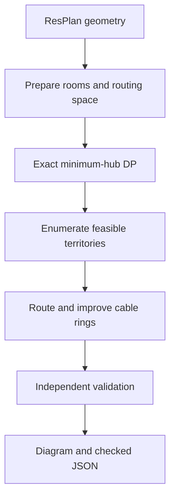

# HubRoute

**A floor-plan cable-ring planner:** assign one device to each eligible room, use the fewest feasible hubs, and route a closed, wall-avoiding cable loop through the devices served by each hub.

HubRoute began as a solver for the Honeywell PS4 problem in UR Hackathon 2026H2. It also includes a local plan browser: load a ResPlan floor plan, inspect its geometry, solve it, review the validator's findings, and export the design as JSON or a diagram.

The central distinction is deliberate: **hub count is solved exactly within the supported plan size and the selected connectivity rule; cable placement is a bounded search, not a proof of globally minimum cable cost.** Every returned solution must pass a separate geometric validator.

## At a glance

| Input | Output |
| --- | --- |
| ResPlan room, wall, window, door, and floor-boundary geometry | A territory for each hub; one device per eligible room; a closed, axis-aligned cable path per hub |
| Room adjacency and area | The minimum feasible hub count under the selected link rule, plus validation and cost metrics |
| Optional plan ID, dataset split, and solve budget | An annotated diagram and a JSON design that is read back and checked before use |

Eligible rooms are living rooms, bedrooms, kitchens, and storage rooms. Bathrooms can be part of the cable's traversable interior but receive no device; stairs are excluded. A hub serves at most five devices and 100 m² of assigned room area. These are the rules encoded in this repository, including its explicit interpretation of room connectivity.

## How a plan becomes a design



### 1. Normalize geometry and define what is possible

[`prepare`](cells/cellP1_prepare.py) converts drawing coordinates to metres, repairs invalid polygons, extracts eligible rooms, and constructs a routing space from interior rooms and doors after subtracting walls and windows. It adds a small wall clearance. The plan's `inner` boundary is applied only when it actually aligns with the eligible rooms; malformed or augmented geometry is surfaced as a flag instead of silently forcing a bad cut.

Room connectivity has two modes. `helper` follows the dataset helper's door/opening graph after additional door checks. The default `physical` mode also requires an open geometric passage between adjacent rooms. A proposed territory must be connected under the chosen mode, stay within one routing-space component, and satisfy the device and area limits. This connectivity choice can change the minimum number of hubs, so it is visible in the app and the result.

### 2. Minimize hubs exactly

For up to **14 eligible rooms**, the preparation step records which subsets of rooms can be served by one hub. A bitmask dynamic program then covers all rooms with the fewest valid subsets:

`best[mask] = min(1 + best[mask without territory])` over feasible territories containing a fixed room in `mask`.

This establishes the minimum hub count under the repository's constraints. It does **not** optimize cable length globally. For larger plans the exact-count path stops and reports a failure rather than presenting an unproved hub count.

### 3. Search for cable rings

[`cellS1_ring_solver.py`](cells/cellS1_ring_solver.py) builds a rectilinear grid inside the allowed routing space. Grid lines follow geometric boundaries and candidate room positions; additional parallel lanes in doors give the search different ways through a narrow opening. Edges are checked against the entire allowed region, not just their endpoints.

Shortest paths run on `(grid vertex, arrival heading)` states. A transition costs its length plus a turn penalty, so a route with the same distance but fewer bends is preferred. For each room, the solver samples candidate device positions near doors, near the room centre, and across the usable floor. It examines cyclic device orders and uses a min-plus dynamic program over candidate positions and headings to choose a closed loop. The best orders are reconstructed, scored using the validator's geometric metrics, and improved by rerouting individual legs with overlap and crossing penalties. A hub is placed on the completed ring when possible, with a short detour fallback.

For multiple hubs, [`cellS11_multi_hub.py`](cells/cellS11_multi_hub.py) enumerates minimum-hub room partitions, ranks them with cheaper territory solves, fully routes a shortlist, and then reroutes one ring while treating the others as fixed obstacles to the score. Its partition cap, shortlist, grid limit, and soft time budget keep the search bounded. This is why the returned cable layout is a *good feasible candidate*, not a global optimum.

### 4. Check the actual design

[`cellV1_validator.py`](cells/cellV1_validator.py) receives the plan context and finished path, then independently checks coverage, one device per eligible room, territory connectivity, hub capacity, room and device placement, closed loops, device visit order, axis-aligned segments, and whether every cable segment stays inside the allowed floor. It also checks the expected hub count. A search result is marked successful only when this validator accepts it.

The metric used to compare layouts is

`J = cable length + 5 × crossings + overlap length + 0.5 × bends`.

Length and overlap are measured in metres. The validator reports both strict crossings and a more conservative count that includes cable touches; the multi-hub search penalizes those extra touches too. These are **cost weights used by this implementation**, not physical installation prices.

[`cellS19_json_export.py`](cells/cellS19_json_export.py) writes hub locations, assigned rooms and nodes, ordered cable segments, lengths, and metrics. Its `check_json` reconstructs a solution **from the serialized file**, validates it again, and compares the stated lengths and objective to the reconstructed geometry. This catches an export that disagrees with the in-memory design.

## Why the algorithm is split this way

| Decision | Reason | Limit |
| --- | --- | --- |
| Exact subset DP for hubs | Hub count is a discrete, high-priority constraint and can be proved for small room sets. | Bounded to 14 eligible rooms. |
| Geometry-based `physical` links | A graph edge alone does not prove a cable can pass between rooms. | The result depends on the chosen connectivity interpretation and clearance. |
| Heading-aware shortest paths | Cable bends matter even when distance is unchanged. | The search is limited to its constructed grid and sampled device positions. |
| Joint rerouting across hubs | Independently good rings can overlap or cross each other. | Only a bounded number of partitions and improvement rounds are explored. |
| Separate validation and JSON round trip | Search scores and exported paths can be wrong independently. | Validation establishes feasibility under encoded rules, not global optimality. |

## Run the local app

Use Python 3.10+ from the repository root:

```bash
python -m venv .venv
source .venv/bin/activate
python -m pip install -r requirements.txt
python -m pip install scipy
python -m uvicorn backend.app:app --port 8000
```

Open [http://127.0.0.1:8000](http://127.0.0.1:8000). The extra SciPy install is required by the solver's sparse shortest-path implementation; it is not currently listed in `requirements.txt`.

The solver also needs the dataset's `resplan_utils.py` module (the helper imported by the original notebook). Put it in `backend/` or make it available on `PYTHONPATH`. To browse the original dataset, put `ResPlan.pkl` in `backend/data/` or set `RESPLAN_PKL` to its path. If present, `split.json` is read beside the pickle. The dataset and helper are **not included** in this repository. Python pickle files should be loaded only from a source you trust.

The app starts without `ResPlan.pkl`; you can upload a plan JSON instead. Uploading and solving still require the helper module. The browser supports plan IDs, dataset splits, uploaded plans, solved-design inspection, and JSON download. A solved plan is cached under `backend/cache/`; use the UI's force solve action or clear the cache after changing the solver.

To convert available dataset plans into portable upload files:

```bash
python tools/export_plans.py --pkl backend/data/ResPlan.pkl --ids 14433 2373 --out samples --verify
python tools/export_plans.py --pkl backend/data/ResPlan.pkl --split val --limit 30 --out samples --bundle
```

The upload format stores the original plan's geometric layers as WKT. [`backend/plan_codec.py`](backend/plan_codec.py) defines the conversion and checks required fields. The generated design JSON is a separate output format; it describes hubs, nodes, ordered cable segments, and metrics rather than the input floor plan.

## API and data flow

The frontend is plain JavaScript and SVG; no build step is needed. [`backend/app.py`](backend/app.py) exposes these routes:

| Route | Purpose |
| --- | --- |
| `GET /api/status` | Solver and dataset readiness. |
| `GET /api/plans`, `GET /api/random` | Browse or select a plan. |
| `POST /api/upload` | Import one plan, a list, or `{ "plans": [...] }`. |
| `GET /api/plans/{id}` | Return plan geometry and any cached result. |
| `POST /api/plans/{id}/solve` | Solve with `seconds`, `link_set`, and optional `force`. |
| `GET /api/plans/{id}/result.json` | Download a solved design. |

[`backend/core.py`](backend/core.py) executes the notebook-derived solver cells in dependency order into one shared namespace. The local API serializes CPU-bound solves with a lock. [`backend/scene.py`](backend/scene.py) turns plan and result geometry into browser data; [`cellS18_design_picture.py`](cells/cellS18_design_picture.py) also produces annotated static diagrams. The batch runner in [`cellS20_batch_runner.py`](cells/cellS20_batch_runner.py) belongs to the notebook workflow: it uses Linux `fork`, writes a summary CSV and one JSON file per plan, and can resume completed files. It is not an API endpoint.

## Verification and known limits

Run `python -m pytest -q` for the repository tests. [`tests/test_codec.py`](tests/test_codec.py) checks the input plan JSON round trip with synthetic geometry and rejects incomplete files. [`tests/test_smoke.py`](tests/test_smoke.py) needs the real dataset and helper. The public repository does not include that data, a full batch result, or a reproducible performance benchmark; run the smoke test and batch runner with your dataset before citing success rates or timing on real plans.

| Situation | What happens |
| --- | --- |
| No eligible rooms, more than 14 eligible rooms, or no feasible room cover | The plan is reported unsolved. |
| A single room exceeds 100 m² | It is flagged; the solver cannot claim a valid capacity-constrained design. |
| Room has no usable grid candidate, geometry disconnects the route, or grid exceeds 20,000 vertices | The route search returns an explicit failure. |
| Multi-hub search reaches its partition or time budget | It considers only the explored candidates; success still requires validation. |
| Device cannot fit at the default inset | The solver retries with no inset and records the retry. |
| Exported JSON does not reproduce the checked route or metrics | The file check reports the mismatch. |

The geometry rules, tolerances, and connectivity assumptions are implementation choices in the linked source. If an external evaluator uses different interpretations of doors, clearances, or special room geometries, its verdict may differ from this validator's. The solver does not silently convert a failed route into a successful one.

## Source map

| Area | Entry point |
| --- | --- |
| Room preparation and exact hub-count DP | [`cells/cellP1_prepare.py`](cells/cellP1_prepare.py) — `prepare`, `p_table`, `p_min_hubs` |
| Single-territory routing and local improvements | [`cells/cellS1_ring_solver.py`](cells/cellS1_ring_solver.py) — `solve_territory`, `solve_h1` |
| Minimum-hub partition search and joint routing | [`cells/cellS11_multi_hub.py`](cells/cellS11_multi_hub.py) — `s11_solve`, `solve_multi` |
| Constraint checks and objective | [`cells/cellV1_validator.py`](cells/cellV1_validator.py) — `validate`, `v_metrics` |
| Solve orchestration and diagram | [`cells/cellS18_design_picture.py`](cells/cellS18_design_picture.py) — `solve_plan`, `draw_design` |
| Output and round-trip verification | [`cells/cellS19_json_export.py`](cells/cellS19_json_export.py) — `plan_to_json`, `check_json` |
| Batch execution | [`cells/cellS20_batch_runner.py`](cells/cellS20_batch_runner.py) — `run_batch` |
| Local app and input format | [`backend/app.py`](backend/app.py), [`backend/plan_codec.py`](backend/plan_codec.py), [`frontend/`](frontend/) |

