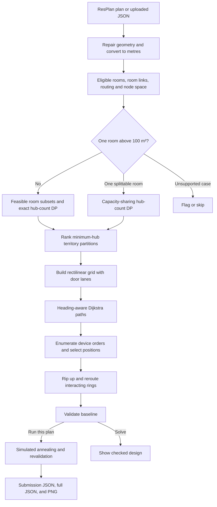
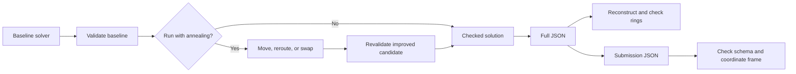

# HubRoute — Minimum-Hub Cable Ring Planning

HubRoute designs cable rings for ResPlan floor plans. It identifies rooms that need devices, determines the minimum feasible number of hubs, assigns rooms to those hubs, and routes a closed cable loop through each hub's devices. A local web app shows the floor plan and the checked design, then exports a submission JSON, a detailed JSON, and a picture.

The difficult part is the order of decisions. Hub count is the primary objective and must be established before cable cost is optimized. Room connectivity depends on doors and actual free floor space. Cable length, bends, overlap, crossings, and wall clearance interact, so a collection of individually short paths can still make a poor ring. This README explains the problem first, then the data exploration and the algorithm chosen for each component.

## Contents

1. [The planning problem](#the-planning-problem)
2. [What dataset exploration revealed](#what-dataset-exploration-revealed)
3. [The complete search pipeline](#the-complete-search-pipeline)
4. [Geometry, clearance, and room links](#geometry-clearance-and-room-links)
5. [Exact hub count and room territories](#exact-hub-count-and-room-territories)
6. [The oversize-room case](#the-oversize-room-case)
7. [Rectilinear routing graph](#rectilinear-routing-graph)
8. [Device order, ring construction, and joint improvement](#device-order-ring-construction-and-joint-improvement)
9. [Simulated annealing](#simulated-annealing)
10. [Validation and export](#validation-and-export)
11. [Results and current limits](#results-and-current-limits)
12. [Run the application](#run-the-application)
13. [Implementation map](#implementation-map)
14. [Future work](#future-work)

## The planning problem

Each eligible room needs one device. A hub serves a connected group of rooms, with a limit of five devices and 100 m² of assigned floor area. One cable ring starts at that hub, visits its devices, and returns to the hub. Its segments must be horizontal or vertical, stay in permitted interior space, and avoid walls and windows. Hubs and devices have their own placement constraints. A cable must not pass through another ring's hub or device.

Eligible room types are living room, bedroom, kitchen, and storage. Rooms below 2 m² are excluded from device assignment in this implementation; cable can still pass through them. Bathrooms can be traversed, while stairs are excluded from the interior routing union. Where room polygons overlap, their shared floor area counts once toward hub capacity.

The objectives are **lexicographic**: minimize hub count `H` first, then minimize cable cost among solutions with that `H`. The reported cost is:

```text
J = L + 5X + O + 0.5B

L  total cable length in metres, including returns and retraces
X  proper cable crossings away from hubs and devices
O  overlapping cable length, counting every extra traversal
B  bends, including reversals and the turn where a ring closes
```

This is a coupled problem. A grouping that uses the minimum number of hubs may force long routes. A short path between two devices may overlap another leg. A placement that simplifies one ring may cause a crossing with another. The solver proves the modeled minimum hub count where its exact search applies, then uses bounded search for low-cost routes and validates the finished geometry. It does not claim a globally minimum `J`.

## What dataset exploration revealed

We examined the ResPlan floor plan representation before choosing the search methods. The figures below describe the source dataset and raw eligible polygon pieces, before the current 2 m² eligibility rule or graph reconstruction. They are useful for sizing the algorithms, but they are not a count of validated solutions.

| Finding | Observation | Algorithmic consequence |
| --- | --- | --- |
| Dataset size | 17,000 plans: 13,053 train, 1,632 validation, 1,632 test, and 683 augmented. | Per-plan effort needs a budget, and evaluation should preserve split boundaries. |
| Drawing scale | Coordinates are drawing units. The per-plan scale has median 18.34 drawing units per metre, ranging from about 6.00 to 726.40. | Convert each plan individually before enforcing metres or square metres. |
| Area metadata | `net_area` is zero or missing in 5,458 plans, about 32%. | Use `area` and `inner` for scale rather than `net_area`. |
| Room count | Raw eligible polygon pieces range from 2 to 10, with median 4; 13,167 plans have 4 or 5. | Exact subset search is practical for hub assignment on this dataset. |
| Large rooms | 428 plans have a raw eligible piece above 100 m² after scaling. | A one-room-one-hub capacity model is insufficient; some plans need area sharing. |

The input also contains multipart and nested rooms, small slivers, and augmented geometries whose `inner` polygon does not align with eligible rooms. These observations led to geometry repair, a tiered device-placement fallback, overlap counted once, and an alignment check before using `inner` as a hard routing boundary. The solver does not classify plans into hand-written shapes; it applies the same pipeline with explicit exceptional cases.

For each plan, the conversion from drawing units to metres is:

```text
s = sqrt(inner.area / area)       drawing units per metre
length_m = length_units / s
area_m² = area_units / s²
```

This normalization comes first. Without it, the 100 m² capacity test, 0.5 m wall clearance, and cable length objective would be incomparable across plans.

## The complete search pipeline



The app has two related actions. **Solve** runs the deterministic baseline. **Run this plan** runs that solver, optionally spends time on simulated annealing, checks the output, and writes the files. The default annealing budget in the UI is six seconds; setting it to zero skips that stage.

## Geometry, clearance, and room links

### The component in plain English

Before choosing hubs or cable paths, the program must know which rooms need devices, which rooms can share a territory, where a device may stand, and which floor space a cable can occupy. It constructs those facts from the plan's polygons rather than treating the stored graph as a complete answer.

`prepare()` rebuilds a room graph using `resplan_utils.plan_to_graph`, filters door and opening links, and offers two interpretations. `helper` keeps the filtered graph links. The default `physical` rule also requires a passage through usable routing space between linked rooms. The routing space begins with interior rooms and doors, removes walls and windows, and shrinks by a 0.03 m margin. An `inner` cut is applied only if `inner` covers at least 95% of eligible-room area, protecting misaligned augmented plans from an artificial loss of floor space.

The default wall and window clearance is 0.5 m. Hubs and devices are kept outside the clearance zone. Cable may enter that zone near a doorway, while remaining outside walls and windows. The solver tries clearance levels `0.5`, `0.3`, `0.1`, and `0` m until it finds a validated design; a reduced clearance is recorded as a flag. Rooms without enough clear placement area can fall back to a less strict placement tier, also with a warning. Thus a validated plan may carry a visible clearance relaxation.

### Why geometry operations fit here

A pure room graph can answer whether rooms are linked, but it cannot certify that a cable fits through a passage or respects wall clearance. A raw polygon-contact test can mistake wall-adjacent rooms for connected rooms. The helper graph supplies candidate relationships; Shapely intersections, differences, and buffers check their physical meaning. Invalid polygons are repaired before and after scaling. A simplified copy of the routing boundary supplies grid lines when round clearance buffers would generate too many vertices, while final paths are still checked against the unsimplified allowed space.

## Exact hub count and room territories

### The component in plain English

A territory is a group of eligible rooms assigned to one hub. It must fit the device and area limits and be connected under the selected link rule. The solver first asks: **What is the fewest number of such groups that covers every eligible room?** Only then does it ask which grouping makes cable routing cheap.

For ordinary plans, each room subset is a bitmask. A subset is feasible when it has at most five rooms, at most 100 m² of union area, and the required connectivity. A dynamic program computes the minimum number of feasible subsets needed to cover every room:

```text
best[0] = 0
best[M] = 1 + min(best[M \ T])
          for feasible T inside M containing M's first room
```

The first-room condition prevents counting the same partition in different orders. The implementation supports exact counting up to 14 eligible rooms. The simple lower bound `max(ceil(N/5), ceil(A/100))` is useful, but connectivity or clearance can require more hubs.

### Why subset DP fits better than a greedy cover

Greedy grouping could commit to a convenient room cluster and later require an unnecessary extra hub, violating the primary objective. Here the dataset's room counts make subset enumeration affordable, so there is no reason to approximate `H`. A general integer program could model the same cover but would introduce a separate solver and still leave the geometric routing problem. Bitmask DP uses the small discrete state directly and gives an exact answer under the modeled constraints.

Several partitions can share the minimum `H` but have different cable costs. The multi-hub search lists minimum-hub partitions up to a cap, orders compact groups first, estimates ring cost cheaply, fully routes the strongest six plus a balanced candidate, then jointly refines the best layouts. The estimates only rank candidates; complete paths are scored and validated later.

## The oversize-room case

A room larger than 100 m² cannot fit into a single hub's area budget. In the supported case of **one** oversize room, the room still has exactly one device on one owner's ring. Other hubs may serve part of its area without adding another device to that room. The shares across hubs must cover the whole room, and each hub's own rooms plus its share must stay within 100 m². Every hub still needs at least one device of its own.

This changes the covering problem. An ordinary subset table would reject the large room or count its full area for one hub. The specialized DP instead tracks which territory owns its device, which other territories can serve it through valid links, and how much capacity each has left. It finds the minimum hub count for which the combined spare capacity covers the large room. The multi-hub router carries those shares through candidate selection and joint improvement; the validator checks the shares again.

Plans with several oversize rooms, or one room that cannot be split across valid hubs, are reported as unsupported by this implementation. This exceptional case is explicit because silently treating an over-capacity hub as valid would undermine the primary objective and the output checker.

## Rectilinear routing graph

### The component in plain English

After hub territories are known, the solver needs legal points for devices and legal cable segments between them. It lays a horizontal and vertical grid over the usable floor, including several parallel lines through doors. Each edge is kept only if its full segment lies within allowed routing space. Candidate device locations come from usable room regions, favoring doors and representative points before spreading additional candidates across the room.

The path state is `(grid vertex, arrival heading)`. Traversing an edge pays its length; changing heading adds the bend cost. Dijkstra finds minimum-cost paths between candidate states under these nonnegative weights. The same precomputed paths can be reused while testing different device locations and visit orders.

### Why this graph and Dijkstra fit

Breadth-first search would minimize edge count, not metres plus turns. Euclidean shortest paths could use forbidden diagonals. A graph without heading would miss the cost of a bend at a vertex. The rectilinear state graph makes axis alignment and turn cost part of the search itself. Door lanes provide alternatives to retracing the same narrow corridor; later overlap and crossing scoring decides whether those lanes help.

This is an exact shortest-path calculation **on the chosen grid**, not a proof of a globally shortest route in continuous space. Grid size is capped, and the multi-hub configuration permits up to 30,000 vertices.

## Device order, ring construction, and joint improvement

### One hub's ring

A ring must choose a device location in every assigned room, an order to visit the devices, and paths between them. With at most five devices, the solver can enumerate cyclic visit orders while fixing a start room and omitting reversed duplicates. For each order, a dynamic program selects candidate device positions and incoming and outgoing headings using the Dijkstra path costs. The best orders are reconstructed as complete loops and scored again.

This combination fits the structure of the problem. Nearest-neighbor ordering can pick an expensive tour. A conventional traveling-salesperson algorithm does not choose physical device locations or account for the direction of approach at each device. Full enumeration of every route combination is too large; the order search and position DP narrow it to plausible rings.

Independently shortest legs can overlap or cross when combined. **Rip-up-and-reroute** removes one leg, penalizes grid edges and conflict points used by other legs, then searches again. It keeps a change only when the whole ring's search score improves. The hub is placed on the finished ring when possible; a short out-and-back stub handles a tight layout. One-device territories use a direct out-and-back ring.

### Several hubs together

Rings that look cheap separately can conflict with each other. The multi-hub stage scores all rings together, including cross-ring overlap and crossings. It re-solves one ring while holding the others fixed, repeats for a bounded number of rounds, and accepts only whole-plan search-score improvements. During search, cable touches are conservatively treated as crossings, and contacts with another ring's hub or device receive a strong penalty. The validator then rejects forbidden foreign-node contacts and reports the challenge's strict `J` separately from the conservative search score.

## Simulated annealing

The deterministic rerouting stage accepts only immediate improvements and can stop at a local minimum. Simulated annealing adds controlled exploration **after a valid baseline exists**. It works on one ring at a time while the other rings stay fixed and tries three moves:

1. Move a device to another valid point in its room and reroute its neighboring legs.
2. Reroute one leg after adding random noise to edge costs, exposing a different legal path.
3. Swap two devices in the visit order and reroute the affected legs.

The annealer scores moves with a conservative whole-plan cost `E`. It accepts an improvement and can also accept a worse move with probability `exp(-ΔE/T)`. Temperature falls during the run, so broad exploration gives way to local refinement. The best candidate replaces the baseline only if its conservative score improves and the complete plan passes the validator. Hub count, room ownership, and oversize-area shares remain fixed.

Annealing is useful here because device positions, visit order, and cable paths interact. A strict hill climb cannot cross a temporary cost increase, while enumerating all combinations is impractical. The app's **Run this plan** flow includes this stage by default for six seconds; **Solve** stops after the deterministic baseline. `cells/cellSA3_sa_experiment.py` contains a before-and-after sampling workflow for measuring its effect.

## Validation and export

The validator evaluates a completed design from geometry rather than trusting the optimizer's internal estimates. It checks room coverage, one device per eligible room, hub capacities, territory connectivity, equipment placement and clearance, visit order, ring closure, axis alignment, routing-space containment, foreign-node contacts, and oversize-area shares. It recomputes `L`, strict and conservative crossings, overlap, bends, and `J` from the finished polylines. The 1 mm tolerance is applied consistently to geometric checks.

The exporter creates two JSON views. The **submission file** contains only the prescribed plan, hub, route, and reported-metric keys. Its coordinates are in metres with a lower-left origin. The **full file** retains nodes, flags, detailed metrics, and area-share information in the solver's coordinate frame. The frame translation assumes the input's y-axis already points upward; `JSON_CFG` makes that convention configurable.

`check_json` reconstructs rings from the full JSON and reruns the validator. `check_submission` checks the submission schema and its coordinate transformation against the full file. These checks are independent of the optimizer's in-memory route objects, although they share the validator's rule implementation. The web view draws SVG in the browser; **Run this plan** also writes a PNG. Small display offsets make overlapping cables visible without changing their checked coordinates.



## Results and current limits

The source data has 17,000 plans, as described above. The project résumé reports a **1.6 s median solve time across the dataset** and a **3–6% cost reduction from simulated annealing**. This README treats those as reported project results: this repository does not include a full-dataset timing table or a paired annealing benchmark artifact from which to independently recompute them. The repository does include a sampling script for the annealing comparison and code that records batch status, timing, clearance, cost, and annealing gain.

The existing project notes record matching notebook and app scores for a few named real plans and a JSON round-trip check. Those are focused checks, not proof that all 17,000 plans are valid under every rule interpretation. Current limits include multiple oversize rooms, some unsplittable single oversize rooms, very narrow placement regions, search caps on grid size and partition count, and an external submission-frame convention that remains configurable. The solver returns a flagged failure when it cannot produce a validated layout within those limits.

## Run the application

From this folder, use Python 3.10 or newer. The data-fetch helper downloads the public ResPlan pickle, split file, and `resplan_utils.py` into the locations expected by the app. You can also put those files in place yourself, or point `RESPLAN_PKL` to a pickle elsewhere; `split.json` is read from the pickle's directory.

```bash
python3 -m venv .venv
source .venv/bin/activate
python -m pip install -r requirements.txt
python tools/fetch_data.py
python -m uvicorn backend.app:app --port 8000
```

Open <http://127.0.0.1:8000>. Use **Solve** for a checked baseline or **Run this plan** to solve, anneal, and write `outputs/plan_<id>.json`, `outputs/plan_<id>_full.json`, and `outputs/plan_<id>.png`. The **Anneal (s)** field can be set to `0`. Without the pickle the server can still start and accept uploaded plan JSON; `resplan_utils.py` must still be importable for the solver to be ready. `GET /api/status` reports data and solver loading errors.

Uploads use the dataset's plan layout as JSON, with geometry layers encoded as WKT. You can export sample files from a pickle with:

```bash
python tools/export_plans.py --pkl backend/data/ResPlan.pkl --ids 14433 2373 --out samples --verify
python tools/export_plans.py --pkl backend/data/ResPlan.pkl --split val --limit 30 --out samples --bundle
```

The stored NetworkX graph is omitted from these files; `resplan_utils.py` reconstructs it from geometry. Solved views are cached in `backend/cache/`; shift-click **Solve** to force a recomputation. After changing solver code, clear stale cache files. `python -m pytest -q` runs the codec tests and, when the data is present, the API smoke tests. The notebook batch runner uses `fork` multiprocessing and is intended for a Linux environment.

## Implementation map

| Component | Source | Responsibility |
| --- | --- | --- |
| Preparation and hub DP | `cells/cellP1_prepare.py` | Scaling, room eligibility, clearance, overlap area, connectivity, ordinary and oversize hub count. |
| One-ring solver | `cells/cellS1_ring_solver.py` | Routing grid, candidate positions, heading-aware Dijkstra, visit-order DP, leg rerouting. |
| Multi-hub solver | `cells/cellS11_multi_hub.py` | Minimum-hub partitions, fast ranking, whole-plan rerouting, area shares. |
| Annealing | `cells/cellSA1_anneal.py` | Device moves, route perturbations, order swaps, temperature schedule, validation gate. |
| Validator | `cells/cellV1_validator.py` | Feasibility checks and cable metrics. |
| Orchestration and drawing | `cells/cellS18_design_picture.py` | Clearance retries, baseline solve, annotated picture helpers. |
| JSON | `cells/cellS19_json_export.py` | Full and submission formats, coordinate frame, round-trip checks. |
| Batch experiment | `cells/cellS20_batch_runner.py`, `cells/cellSA3_sa_experiment.py` | Split-aware batch output and sampled annealing comparison. |
| Web server | `backend/core.py`, `backend/app.py` | Load cells and data, API, caching, Run workflow, saved files. |
| Browser | `frontend/` | Plan browser, SVG view, controls, upload, downloads. |
| Data utilities | `tools/fetch_data.py`, `tools/export_plans.py` | Fetch source data and create uploadable JSON. |

The main API operations are `GET /api/status`, `GET /api/plans`, `GET /api/plans/{id}`, `POST /api/upload`, `POST /api/plans/{id}/solve`, and `POST /api/plans/{id}/run`. Solved plans can be retrieved through `/result.json` and `/full.json`; the Run flow serves its saved submission JSON, full JSON, and PNG through `/files/{json|full|png}`. The `/run` request accepts `seconds`, `anneal_seconds`, and `link_set`.

## Future work

### Reinforcement learning to guide expensive search

A policy could choose the next territory partition or local route move using the current room graph, occupied cable edges, clearance status, and cost breakdown as state. Its reward should be improvement in `J` under the same hub count and time budget, with invalid proposals rejected by the existing validator. The useful comparison is against the deterministic solver plus annealing on held-out plans, counting both quality and runtime. The learned policy would guide candidate choice; it would not replace exact hub counting or validation.

### Evolutionary search over complete layouts

A population could retain several valid minimum-hub partitions and ring layouts rather than improving only one. Mutation could alter a grouping, device position, visit order, or route leg; crossover could exchange compatible territories between layouts. A repair step would restore connectivity, capacity, and route feasibility before selection. This could explore different basins of the joint routing problem, especially when several territory partitions have similar proxy costs. Evaluation should use the same fixed splits and compute budget as the current pipeline so a larger search budget is not mistaken for an algorithmic gain.
