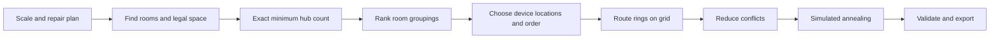

# HubRoute

HubRoute plans cable rings on residential floor plans. It chooses the smallest feasible number of hubs, assigns rooms to them, places devices, and routes each hub's cable through its devices and back. A local web app displays the plan and exports checked results.

The decisions interact. A room grouping can satisfy every hub limit but require a long cable route. A short route can overlap another cable or add crossings. HubRoute therefore finds the **exact minimum hub count** for supported cases, then searches for a low-cost layout at that hub count.

## Problem

Each eligible room needs one device. A hub serves a connected group of rooms and has two limits: **at most five devices** and **at most 100 m² of assigned floor area**. Its cable starts at the hub, visits every assigned device, and returns to the hub. Cable segments must be horizontal or vertical and stay in permitted interior space. Walls, windows, equipment placement, and clearance constrain the design.

The goals have a strict order:

1. Use the **fewest feasible hubs**.
2. Among designs with that hub count, reduce cable length, crossings, overlap, and bends.

The validator reports cable cost as:

```text
J = L + 5X + O + 0.5B

L = cable length in metres, including returns and retraced segments
X = proper cable crossings away from hubs and devices
O = overlapping cable length, counting extra traversals
B = bends, including reversals and the turn that closes a ring
```

The minimum hub count can be proved for supported room configurations. The lowest possible cable cost in continuous space is not proved: routing uses a finite grid and bounded improvement searches. Every returned layout is checked against the implemented rules.

## Dataset description

HubRoute uses **ResPlan**, a collection of **17,000 residential floor plans**. Each plan provides polygon geometry for rooms, doors, walls, windows, and an interior outline, along with area information. The dataset splits contain 13,053 training, 1,632 validation, 1,632 test, and 683 augmented plans.

Coordinates are in drawing units rather than metres. HubRoute derives a scale for each plan and converts lengths and areas before applying hub capacity, wall clearance, or cable cost:

```text
s = sqrt(inner.area / area)       drawing units per metre
length_m = length_units / s
area_m² = area_units / s²
```

Living rooms, bedrooms, kitchens, and storage rooms are eligible for devices. This implementation excludes eligible room pieces smaller than 2 m² from device assignment, although cable may pass through them. Bathrooms can be traversed; stairs are excluded from the routing interior. Where room polygons overlap, shared floor area counts once toward hub capacity.

The application reads the dataset pickle and rebuilds room relationships from geometry using `resplan_utils.py`. It also accepts uploaded plan JSON whose geometry layers are encoded as WKT.

## Data exploration

We inspected the source plans **before** choosing search methods. These counts describe raw eligible polygon pieces before the current 2 m² filter and graph reconstruction; they are not counts of validated solutions.

| What we found | Observation | Why it matters |
| --- | --- | --- |
| Plans are numerous | 17,000 plans across four splits. | Per-plan work needs a time budget. |
| Scale varies widely | Median scale is 18.34 drawing units per metre; the range is about 6.00 to 726.40. | Capacity, clearance, and cable cost need a per-plan metre conversion. |
| Area metadata is incomplete | `net_area` is zero or missing in 5,458 plans, about 32%. | Derive scale from `area` and `inner` instead. |
| Most plans have few relevant rooms | Raw eligible pieces range from 2 to 10, with a median of 4. In 13,167 plans there are 4 or 5. | Exact subset and device-order searches are practical. |
| Some rooms exceed hub capacity alone | 428 plans contain a raw eligible piece above 100 m² after scaling. | A special area-sharing case is needed. |

The geometry also contains multipart rooms, small slivers, overlaps, and some augmented plans whose `inner` outline does not align with eligible rooms. HubRoute repairs invalid polygons, counts overlapping area once, and applies `inner` as a hard routing boundary only when it covers at least 95% of eligible-room area. These safeguards came from inspecting the data.

## How the solver works

The pipeline starts with geometry, proves the supported minimum hub count, considers room groupings at that count, builds cable rings, and improves the whole layout. The validator checks the result after optimization.



### 1. Prepare rooms and legal space

**In plain English:** The solver determines which rooms need devices, which rooms connect through openings, where devices and hubs may sit, and where cable may run.

**Requirement:** Rooms that touch across a wall must not be considered connected. Equipment needs clear placement space, and cable must remain inside allowed space.

**Method:** `prepare()` repairs and scales polygons, rebuilds the room graph, and filters door and opening links. The default `physical` link rule also checks for a passage through usable routing space. Polygon intersections, differences, and buffers define cable and equipment regions. The solver starts with 0.5 m wall and window clearance and, if needed, tries 0.3 m, 0.1 m, and 0 m. Any relaxation is recorded. Cable may enter a clearance zone near a doorway while still avoiding the wall or window itself.

**Why this method:** A room graph alone cannot prove that a cable fits through a passage. Polygon contact alone can mistake a shared wall for a door. Graph links supply candidates; geometry confirms physical access.

### 2. Hubs: how many are necessary?

**In plain English:** Consider the possible groups of rooms one hub could serve, then find the fewest such groups that cover every eligible room.

**Requirement:** Each group must be connected, contain at most five devices, and use at most 100 m² of union area. The hub count must be globally smallest under these modeled rules, since it is the primary objective.

**Method — bitmask dynamic programming:** Give each room one bit. A subset is feasible when it satisfies connectivity, device, and area limits. A dynamic program finds the minimum number of feasible subsets needed to cover any remaining set of rooms:

```text
best[0] = 0
best[M] = 1 + min(best[M \ T])
          over feasible T inside M containing M's first room
```

Requiring the chosen subset to contain the first remaining room avoids reconsidering the same partition in different orders. The ordinary exact search supports up to 14 eligible rooms, covering the observed raw room-count range.

**Why this algorithm:** A greedy grouping can use an unnecessary extra hub because an early choice blocks a better later one. The lower bound `max(ceil(rooms/5), ceil(area/100))` misses connectivity. The small room counts make subset DP affordable. A general integer-programming solver could express the same cover but would add a dependency without simplifying geometric routing.

**Large-room exception:** One room above 100 m² cannot fit whole in one hub's area budget. In the supported case, it has **one device on one owner's ring** while other connected hubs may serve shares of its area without adding another device there. A specialized DP tracks ownership, valid links, and spare hub capacity to find the minimum feasible hub count. Multiple oversize rooms and unsplittable cases are reported as unsupported.

### 3. Zones: which rooms go with each hub?

**In plain English:** Several room groupings may all use the minimum number of hubs. Compare them to find ones likely to need less cable.

**Requirement:** Every candidate must still satisfy hub count, connectivity, device, and area limits. Comparing candidates must leave time for full routing.

**Method — backtracking and ranking:** Backtrack through minimum-hub partitions, subject to a search cap. Give each grouping a quick cable-cost estimate; fully route the strongest six plus a balanced candidate, then refine promising complete layouts. The estimate only filters candidates. The final choice uses actual routed geometry and validation.

**Why this algorithm:** Taking only the first minimum-hub partition ignores cable cost. Fully routing every partition can spend the budget on weak candidates. Backtracking retains choices at the right hub count; cheap ranking focuses expensive routing. Because this stage is capped, it does **not** prove the minimum cable cost among all minimum-hub partitions.

### 4. Node order: which device comes next?

**In plain English:** Decide the order in which a hub's cable visits its devices and returns home.

**Requirement:** Visit each assigned device once in the order and close the ring. Order should reflect legal route costs, not just straight-line distances.

**Method — exhaustive search:** A hub has at most five devices, so the solver enumerates cyclic visit orders, fixes a start room, and skips reversed duplicates. For each order, a dynamic program selects candidate device locations and arrival/departure headings using precomputed path costs. The best complete loops are reconstructed and scored.

**Why this algorithm:** A nearest-neighbor rule can create a costly final return. A standard traveling-salesperson calculation over fixed points misses choices of device position and approach direction. Five devices make exhaustive order search small enough to avoid those approximations.

### 5. Routing: where does each cable go?

**In plain English:** Lay a horizontal and vertical network over the floor plan and find legal cable paths between selected nodes, much as a map app finds routes on roads.

**Requirement:** Every segment must be axis-aligned, stay in permitted space, and account for both distance and turns. Routes must pass through narrow openings.

**Method — heading-aware Dijkstra:** Grid lines are derived from floor-plan geometry, including doors and parallel door lanes. An edge is kept only if its whole segment lies in allowed space. A search state is `(grid vertex, arrival heading)`; an edge costs its length, and changing heading adds a turn penalty. Dijkstra finds a cheapest path on this graph under nonnegative costs. Paths are reused while testing device locations and visit orders.

**Why this algorithm:** Breadth-first search counts edges rather than metres. A shortest-path graph without heading cannot price bends correctly. A continuous straight-line route could introduce forbidden diagonals or wall crossings. The rectilinear graph and heading state encode the cable rules. Results are shortest **on the chosen grid**; grid-size caps mean they are not proofs of continuous-space optimality.

### 6. Reduce crossings, overlap, and bends

**In plain English:** Short cable legs can interfere when combined. Give them alternate lanes through doors, then lift and reroute conflicting legs or rings while accounting for the rest of the layout.

**Requirement:** A change to one cable should help the combined plan and must not create forbidden contacts with another ring's hub or device.

**Method:** Several **parallel lanes** through a door let cables pass side by side rather than on top of each other. **Rip-up-and-reroute** removes one leg, penalizes grid edges and conflict points used by other legs, and searches for a replacement. With multiple hubs, the solver can re-solve an entire ring while holding others fixed. It keeps a change only if the whole-plan search score improves. The **turn penalty** in Dijkstra already favors straighter paths.

**Why these methods:** Independent shortest legs ignore cable interactions. A fixed lane assignment cannot handle every floor-plan shape. Rerouting exposes local conflicts to path search, and parallel lanes give it alternatives. Search treats cable touches conservatively; final validation computes the stricter reported crossing count and rejects forbidden contacts.

### 7. Final improvement with simulated annealing

**In plain English:** Start with a valid design and make small changes: move a device, lay a cable leg differently, or swap two devices in a ring's visit order. At first, sometimes accept a slightly worse change to escape a local minimum; become more selective over time.

**Requirement:** Hub count, room ownership, and large-room area shares stay fixed. A final candidate must improve the solver's conservative whole-plan score and pass validation.

**Method:** The annealer scores a candidate with whole-plan cost `E`. It accepts an improvement and may accept a worse move with probability `exp(-ΔE/T)`. Temperature `T` falls during the time budget. The best valid candidate replaces the baseline only if its conservative score improves. **Run this plan** uses six seconds of annealing by default; setting it to zero skips this stage. **Solve** stops after the deterministic baseline.

**Why this algorithm:** An improvement-only search can stall because a temporary cost increase may enable a better layout. Enumerating all positions, orders, and routes is too expensive. Simulated annealing explores nearby layouts under a fixed budget while retaining the best validated result.

### 8. Validate and export

**In plain English:** Check the finished drawing again instead of trusting search estimates, then save the checked plan.

**Requirement:** Rooms must be covered, hubs must respect capacity and connectivity, equipment and cable must be legal, rings must close, segments must be axis-aligned, and reported cost must match final geometry.

**Method:** The validator recomputes length, crossings, overlap, bends, and `J` from finished polylines with a 1 mm geometry tolerance. The exporter writes a compact submission JSON, a detailed full JSON, and a PNG. JSON checking reconstructs rings from exported data and validates them again. Submission coordinates are in metres with a lower-left origin; the full file also keeps flags, nodes, metrics, and area-share information.

**Why this step:** Ranking estimates, graph costs, and annealing scores guide search but can miss an error in the final drawing. Rechecking exported geometry catches these errors and makes clearance relaxations visible.

## Results

The project résumé reports a **1.6 s median solve time across 17,000 plans** and a **3–6% cable-cost reduction from simulated annealing**. These are reported results. This repository does not include a full-dataset timing table or paired annealing benchmark artifact from which to independently recompute them. It does include a sampled annealing comparison script and batch code that records timing, status, cost, clearance, and annealing gain.

The solver proves the modeled minimum hub count for ordinary plans and the implemented single oversize-room case, then uses bounded search for cable quality. Current limits include multiple oversize rooms, unsplittable large rooms, narrow placement regions, and grid and partition search caps. A plan that cannot be validated within those limits is flagged rather than silently returned as valid.

## How the results could improve further

### Reinforcement learning

A learned policy could choose which minimum-hub grouping to route next, or which device move or cable leg to change next. Its state could include the room graph, occupied cable edges, clearance status, and length/crossing/overlap/bend breakdown. Reward could be reduction in validated `J` under the same hub count and time budget. The exact hub-count solver and validator would remain feasibility checks. Evaluation should compare this policy with the current baseline plus annealing on held-out plans, measuring quality and runtime.

### Evolutionary algorithms

An evolutionary search could keep several valid minimum-hub layouts instead of improving only one. Mutation could alter a zone, device position, visit order, or cable leg; crossover could combine compatible territories from different layouts. Repair and validation would restore connectivity, capacity, and routing feasibility before selection. This could explore distinct good layouts when candidate rankings are similar. A fair comparison would use the same data splits and compute budget as the current pipeline.

## Run the application

Use Python 3.10 or newer. From the `cable-ring 2` directory:

```bash
python3 -m venv .venv
source .venv/bin/activate
python -m pip install -r requirements.txt
python tools/fetch_data.py
python -m uvicorn backend.app:app --port 8000
```

Open <http://127.0.0.1:8000>. The data helper downloads the public ResPlan pickle, split file, and `resplan_utils.py` into the locations expected by the app. You can instead place them there yourself or set `RESPLAN_PKL` to another pickle path; `split.json` is read from that pickle's directory. Without the pickle, the server can still start and accept uploaded plan JSON, but `resplan_utils.py` must be importable for solving. `GET /api/status` reports loading errors.

Use **Solve** for a checked baseline. Use **Run this plan** to solve, optionally anneal, and save `outputs/plan_<id>.json`, `outputs/plan_<id>_full.json`, and `outputs/plan_<id>.png`. Set **Anneal (s)** to `0` to skip that stage. Results are cached in `backend/cache/`; shift-click **Solve** to recompute after changing solver code.

To create uploadable sample JSON from a dataset pickle:

```bash
python tools/export_plans.py --pkl backend/data/ResPlan.pkl --ids 14433 2373 --out samples --verify
```
